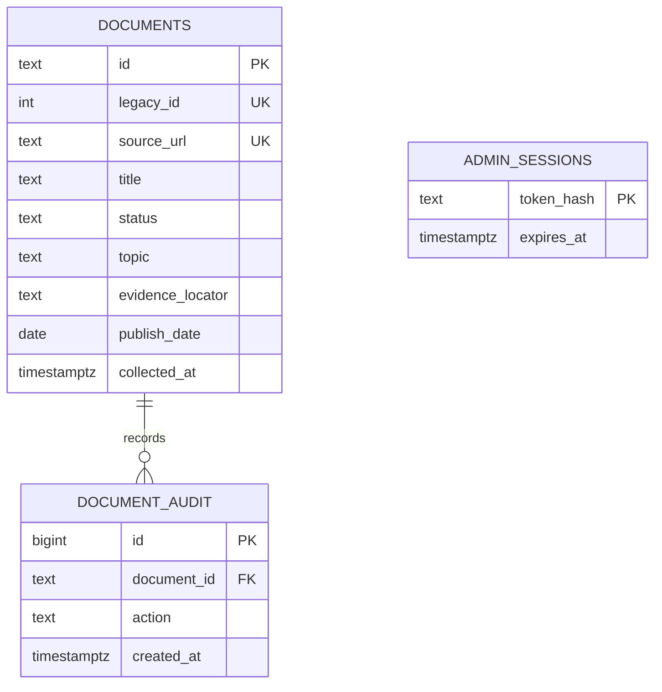

# API contract and storage

All paths are same-origin. JSON requests use `Content-Type: application/json`. Dates in `publishDate` use `YYYY-MM-DD`. Collection and audit timestamps use ISO 8601. Errors use `{ error: { code, message } }`.

| Method | Path | Purpose |
| --- | --- | --- |
| GET | `/api/v1/livez` | Process liveness for probes |
| GET | `/api/v1/health` | Process and database readiness |
| GET | `/api/v1/documents` | Published document list and facets |
| GET | `/api/v1/documents/:id` | Published document, including provenance and classroom analysis |
| GET | `/api/v1/analytics` | Count, latest collection, monthly, regional, legacy category and primary topic breakdowns |
| GET/POST/DELETE | `/api/v1/admin/session` | Read, create or end the maintenance session |
| GET | `/api/v1/admin/topics` | Return the primary topic options |
| GET | `/api/v1/admin/sources` | Return pre-configured intake sources |
| POST | `/api/v1/admin/intake` | Fetch metadata for a configured source ID and return a draft preview |
| GET/POST | `/api/v1/admin/documents` | List all workflow states or create a draft |
| PATCH | `/api/v1/admin/documents/:id` | Update editor fields |
| POST | `/api/v1/admin/documents/:id/publish` | Publish |
| POST | `/api/v1/admin/documents/:id/archive` | Archive |
| GET | `/api/v1/admin/audit` | Paginated maintenance activity |

Shared parameters are `q`, `region`, `category`, `topic`, `sourceType`, `dateFrom` and `dateTo`. A `category` filter matches the original classification, and a `topic` filter matches the primary topic. Both filters can be used together. Document lists accept `page` and `pageSize` (1–50, default 20), and maintenance lists accept `status`. Audit accepts the same pagination parameters with a default size of 10 and returns `{items,total,page,pageSize}` sorted by descending audit ID. Each audit item includes the document title captured at the time of the operation. Facets and breakdowns contain `{label,count}` entries. A list returns `{items,total,page,pageSize,facets}`. Analytics and list facets include `topics` alongside legacy `categories`. Keyword matching includes titles, topics and evidence text. Date filters and monthly totals use the publish date. Counts include the same published document universe. Entries without a publish date remain visible in unfiltered lists and are excluded from monthly buckets.

See the SQL migration for the exact schema. Maintenance uses an opaque session cookie. Authentication values are supplied at runtime. Updates and audit events use database transactions. A duplicate canonical URL is rejected with HTTP 409.

Authenticated batch import uses `POST /api/v1/admin/documents/import` with `{documents: DocumentInput[]}`. It validates all 1–100 items before writing, inserts drafts and audit events in one transaction, and returns `{created,skipped}`. Duplicate source URLs are skipped.

Document reads include the resolved `topic`, `topicConfirmed`, `evidenceLocator` and nullable `evidenceSourceUrl`. The optional evidence URL identifies the text cited by the locator when it differs from the catalogue source. Draft inputs can set a supported primary `topic` while retaining the original `category`. If an imported category has no alias, it resolves to “其他” for display and requires an explicit topic selection before publishing. A transition to published returns HTTP 409 with `INCOMPLETE_PUBLICATION` until the document has a topic, classroom analysis and an excerpt or source summary with its locator.
