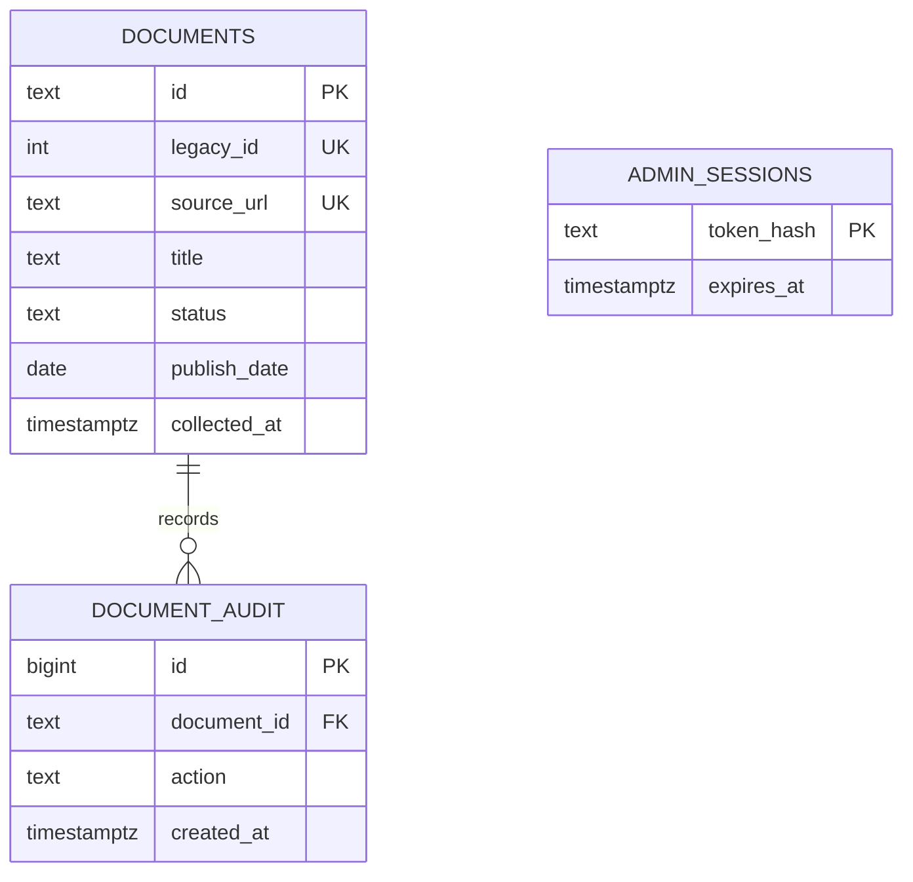

# API contract and storage

All paths are same-origin. JSON requests use `Content-Type: application/json`. Dates in `publishDate` use `YYYY-MM-DD`. Collection and audit timestamps use ISO 8601. Errors use `{ error: { code, message } }`.

| Method | Path | Purpose |
| --- | --- | --- |
| GET | `/api/v1/livez` | Process liveness for probes |
| GET | `/api/v1/health` | Process and database readiness |
| GET | `/api/v1/documents` | Published document list and facets |
| GET | `/api/v1/documents/:id` | Published document, including provenance and classroom analysis |
| GET | `/api/v1/analytics` | Count, latest collection, monthly, regional and category breakdowns |
| GET/POST/DELETE | `/api/v1/admin/session` | Read, create or end the maintenance session |
| GET | `/api/v1/admin/sources` | Return pre-configured intake sources |
| POST | `/api/v1/admin/intake` | Fetch metadata for a configured source ID and return a draft preview |
| GET/POST | `/api/v1/admin/documents` | List all workflow states or create a draft |
| PATCH | `/api/v1/admin/documents/:id` | Update editor fields |
| POST | `/api/v1/admin/documents/:id/publish` | Publish |
| POST | `/api/v1/admin/documents/:id/archive` | Archive |
| GET | `/api/v1/admin/audit` | Recent maintenance activity |

Shared parameters are `q`, `region`, `category`, `sourceType`, `dateFrom` and `dateTo`. Document lists add `page`, and maintenance lists accept `status`. Facets and breakdowns contain `{label,count}` entries. A list returns `{items,total,page,pageSize,facets}`. Keyword matching includes titles and evidence text. Date filters and monthly totals use the publish date. Counts include the same published document universe. Entries without a publish date remain visible in unfiltered lists and are excluded from monthly buckets.

See the SQL migration for the exact schema. Maintenance uses an opaque session cookie. Authentication values are supplied at runtime. Updates and audit events use database transactions. A duplicate canonical URL is rejected with HTTP 409.

Authenticated batch import uses `POST /api/v1/admin/documents/import` with `{documents: DocumentInput[]}`. It validates all 1–100 items before writing, inserts drafts and audit events in one transaction, and returns `{created,skipped}`. Duplicate source URLs are skipped.
